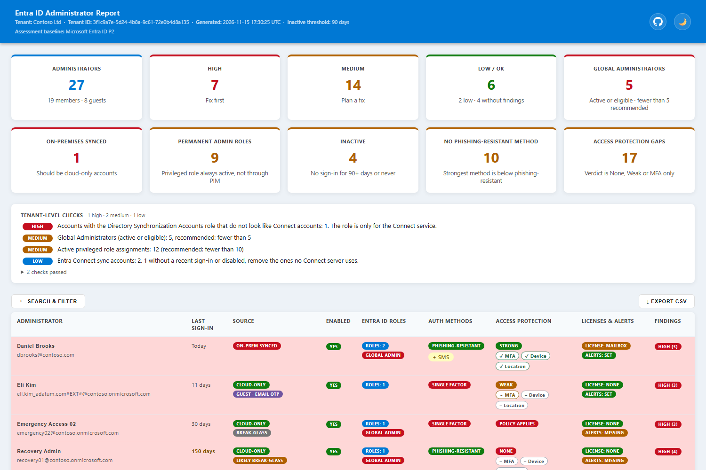

# Entra ID Administrator Report

Generates an interactive, self-contained HTML report of every administrator account in a Microsoft Entra ID tenant and checks each one against the Microsoft Learn recommendations for administrator accounts. Each account gets a severity (**High / Medium / Low / OK**) with the findings behind it. The report can run as a weekly automated report in Azure DevOps.

Service principals with roles are out of scope; the report covers user accounts only.

## Demo

[](docs/demo/index.html)

Three demo reports for a fictional tenant (Contoso Ltd) show the three baselines. Open a file in a browser; no server is needed. If you publish the repo with GitHub Pages, they are served from `/docs/demo/`.


| Demo | Baseline | Shows |
|------|----------|-------|
| [docs/demo/index.html](docs/demo/index.html) | P2 | Everything: synced and guest admins, standing and eligible roles, roles through groups and PIM for Groups, phishing-resistant method gaps, Conditional Access gaps, break-glass and Entra Connect sync accounts |
| [docs/demo/p1.html](docs/demo/p1.html) | P1 | The same tenant without PIM |
| [docs/demo/free.html](docs/demo/free.html) | Free | Security defaults enabled; sign-in activity, authentication methods, Conditional Access and PIM show "Not assessed" |

To rebuild them, run `pwsh -File tools/Build-Demos.ps1`. The data generator in `tools/` is fictional and replaces the Microsoft Graph calls, so no tenant is contacted.

## What it does

You tell the script which Microsoft Entra ID license level to assess against with the required `-LicenseBaseline` parameter (`Free`, `P1` or `P2`). Only the controls of that level are checked, recommended and summarised; the script does not detect the tenant's licenses. The report header shows the baseline.

### Every baseline

- **Who is an administrator**: every user who holds or is eligible for a Microsoft Entra role
  - directly, active or eligible (PIM), tenant-wide or limited to an administrative unit or a single object (see [Role scope](#role-scope))
  - through a group that holds a role (members, including nested)
  - through PIM for Groups (eligible members of such a group)
  - as **owner** of such a group, because an owner can add members
- **Source**: cloud-only or synchronized from on-premises Active Directory
- **Standing vs. just-in-time access** (P2): permanent, time-bound, activated (PIM) or eligible
- **Licenses**: assigned licenses, with a signal for an Exchange Online mailbox or other daily-use workloads (Teams, SharePoint, Office apps)
- **Notification email**: the Email and Alternate email addresses (plus addresses are recognized), and whether Entra notifications (ID Protection, PIM) can reach the administrator. The **Licenses & alerts** column shows a License badge (Mailbox, Productivity, Other, None) and an Alerts badge (Missing, Set, N/A for Entra Connect sync accounts). Both open a modal with a status banner, the licenses with their flagged service plans, the Email and Alternate email, and a recommended action when one is needed
- **Security defaults**: read for every baseline. With the Free baseline they decide the Access protection verdict.
- **Break-glass hint**: accounts that look like emergency access accounts
- **Entra Connect sync accounts**: recognized and checked as service accounts, see [Entra Connect sync accounts](#entra-connect-sync-accounts)
- **Tenant-level checks**: number of Global Administrators, number of privileged role assignments, number of break-glass accounts

### What each baseline assesses

| Area | Free | P1 | P2 |
|------|:----:|:--:|:--:|
| Source, guests, sync accounts, break-glass, roles, owned groups, Global Administrator count, licenses and notification email | yes | yes | yes |
| Security defaults | yes | yes | yes |
| Conditional Access and the **Access protection** column, see [Access protection](#access-protection) | no (security defaults only) | yes | yes |
| Last sign-in and inactivity findings | no | yes | yes |
| Authentication methods, see [Auth methods](#auth-methods) | no | yes | yes |
| Privileged Identity Management: eligible and activated assignments, standing privilege | no | no | yes |

Columns that a baseline does not assess stay in the table and show "Not assessed", and their filters and summary cards are left out. With the Free and P1 baselines one tenant-level info finding says that PIM is not part of the baseline and that role assignments are shown as assigned. `-BreakGlassAccounts` checks the named accounts against the emergency access recommendations instead of the regular ones.
## Findings

| Finding | Severity |
|---------|----------|
| Synchronized from on-premises AD with a tenant-wide privileged role | High |
| Synchronized from on-premises AD, other roles (or a privileged role limited to an administrative unit or object) | Medium |
| Guest or external account with administrator access | Medium, High with a Tier 0 role |
| Single factor: no multifactor method registered | High |
| No enabled Conditional Access policy requires MFA (P1, P2) | High |
| MFA not enforced and security defaults off (Free) | Medium (the tenant-level check is High) |
| Standing (always active) tenant-wide privileged Entra role (P2) | Medium |
| Standing privileged Entra role limited to an administrative unit or object (P2) | Low |
| Owner of a group that holds roles | Medium |
| No sign-in for `-InactiveDays` (default 90) days, or never (P1, P2) | Medium |
| Exchange Online mailbox license (recommendation: remove it, use a plus address of the owner's personal mailbox as Email) | Medium |
| Strongest method is passwordless MFA or multifactor, not phishing-resistant | Medium |
| MFA required only for some resources or conditions | Medium |
| MFA required, but not phishing-resistant MFA (P1, P2) | Medium |
| Phishing-resistant MFA enforced, but no compliant or hybrid joined device and no trusted location required | Medium |
| Security defaults on, account holds a role that security defaults do not cover (P1, P2 baseline adds a Conditional Access hint) | Low |
| Other daily-use service plans (Teams, SharePoint, Microsoft 365 Apps) | Low |
| No Email and no Alternate email, and the account holds Global Administrator, Security Administrator, Security Reader or Privileged Role Administrator (tenant-wide, active or eligible) | Medium |
| No Email and no Alternate email, other administrators | Low |
| Fewer than two Global Administrators with an Email or Alternate email (tenant-level check) | Medium |
| Disabled account that still has role assignments | Low |
| Phishing-resistant method registered, but SMS or voice remain and no Conditional Access policy requires phishing-resistant MFA | Low |
| MFA required only after an eligible role is activated | Low |
| Phishing-resistant MFA enforced, but no sign-in frequency set or above `-MaxSignInFrequencyHours` | Low |

The row severity is the highest finding. The severities are this report's own ranking; the recommendations behind them come from Microsoft Learn:

- [Best practices for Microsoft Entra roles](https://learn.microsoft.com/entra/identity/role-based-access-control/best-practices): least privilege, PIM, MFA, fewer than 5 Global Administrators, fewer than 10 privileged role assignments, cloud-native accounts
- [Securing privileged access for hybrid and cloud deployments](https://learn.microsoft.com/entra/identity/role-based-access-control/security-planning): separate administrator accounts, mail forwarded to a working mailbox, cloud-only accounts
- [Manage emergency access accounts](https://learn.microsoft.com/entra/identity/role-based-access-control/security-emergency-access)
- [Protect your Microsoft 365 privileged accounts](https://learn.microsoft.com/microsoft-365/enterprise/protect-your-global-administrator-accounts)

### Access protection

With the P1 or P2 baseline the **Access protection** column answers one question per administrator: is the account protected by a Conditional Access policy that requires phishing-resistant MFA plus at least one extra control (a compliant or hybrid joined device, or a trusted location)? That follows the Microsoft recommendation to pair phishing-resistant MFA for administrators with a managed device and/or a trusted location. A badge shows the verdict, and three pills show the requirements behind it: a check mark is met, a tilde is weaker, a dash is missing. The badge and the pills open the **Access protection** view with a banner, the three requirements (the best policy that meets each, and why a policy that exists is not counted), a recommendation, the sign-in frequency and the list of policies that apply. With the Free baseline no Conditional Access is read: the verdict is **Security defaults** when they are enabled and **None** when they are not.

| Verdict | Condition | Colour |
|---------|-----------|--------|
| **Strong** | Phishing-resistant MFA, a device requirement and a trusted location | Green |
| **Good** | Phishing-resistant MFA plus a device requirement or a trusted location | Green |
| **MFA only** | Phishing-resistant MFA, no device or location requirement | Amber |
| **Weak** | MFA that is not phishing-resistant, covers only some resources, or applies only after role activation | Amber |
| **None** | No enabled policy requires MFA | Red |
| **Security defaults** | Security defaults are enabled (and no Conditional Access policy is enabled, because the two cannot both be active). Applies to every account except Entra Connect sync accounts, break-glass accounts included. Security defaults require MFA on every sign-in for 16 administrator roles ([list on Learn](https://learn.microsoft.com/entra/fundamentals/security-defaults#enforced-security-policies)); an account without one of them gets the weaker wording and a Low finding | Blue |
| **Policy applies** | A break-glass account that an enabled Conditional Access policy applies to | Red |
| **N/A** | Does not apply: break-glass accounts that are excluded from the policies, and Entra Connect sync accounts | Gray |

How each requirement is decided, for enabled policies that apply to the account:

- **MFA** counts when a policy for all resources requires a phishing-resistant authentication strength. A policy for selected resources (for example only the Microsoft Admin Portals), or for all resources with exclusions, does not count and gives Weak.
- **Device** counts when the grant requires a compliant device, a hybrid joined device, or both, for all resources. A policy that accepts "compliant, hybrid joined, **or** MFA" does not guarantee a device and shows as weaker. Microsoft Entra joined devices are covered through compliance, because there is no separate join requirement.
- **Location** counts for a policy that blocks access from all locations except trusted ones. The excluded locations are read from the named locations: IP ranges marked trusted or the Global Secure Access compliant network count; a country list is weaker and does not count for the verdict.
- **Sign-in frequency** is shown in the access protection view only. It takes the strictest frequency among the policies that apply; "every time" counts as 0. Microsoft publishes no single value for administrators, so `-MaxSignInFrequencyHours` is this report's own limit (default 4). Learn's own template uses 1 hour for unmanaged devices and recommends longer sessions only on managed ones.
- Any other narrowing condition (platform, client app, risk, device filter) makes a policy partial. Report-only policies are listed but not counted. Break-glass accounts are meant to be excluded from these policies, so they show N/A.

The report judges each account against the baseline you chose; it does not look at the tenant's licenses. With the Free baseline, Conditional Access, device and location requirements are not assessed. With P1 or P2 they are, and security defaults and enabled Conditional Access policies are treated as mutually exclusive (Microsoft Entra does not allow both). Under security defaults the verdict is **Security defaults**: MFA is required on every sign-in (not phishing-resistant), device and location requirements show as Not available (Free) or Not configured (P1/P2), and there is no finding per account. Break-glass accounts are not excluded from security defaults, so their view warns that they can be locked out if MFA is unavailable. A banner at the top of the report follows the baseline and the security defaults state: blue for Free with security defaults on, red for Free with them off, gray for P1/P2 with security defaults on and no policy in use. If the security defaults state cannot be read, the report says so under "Some data could not be read".

The filters are **Access protection** (one tag per verdict, the Security defaults tag only when an account has it), and with P1 or P2 **Trusted Device** and **Trusted Location**. The CSV export has the columns AccessProtection, MfaRequirement, DeviceRequirement, LocationRequirement and SignInFrequency, and, at the end of every row, ConditionalAccessAvailable (Yes for P1/P2, No for Free) and SecurityDefaultsEnabled (Yes, No or Unknown).
The summary card **Conditional Access Gaps** counts administrators whose verdict is Weak or None. The summary card **No Trusted Device or Location** counts administrators for whom neither a managed device nor a trusted location is required. The severity of the missing control follows the table in [Findings](#findings).

### Auth methods

The **Auth methods** column says what an administrator has registered and can use. Whether MFA is required is shown in [Access protection](#access-protection). Every administrator gets one badge, the strongest tier their registered methods reach, using the authentication strengths of Microsoft Entra ID, Click the badge for the registered methods per tier.

| Tier | Registered methods that reach it |
|------|----------------------------------|
| **Phishing-resistant** | Windows Hello for Business, passkeys (device-bound, FIDO2 security key, synced), platform credential on macOS, certificate-based authentication |
| **Passwordless** | Microsoft Authenticator phone sign-in |
| **MFA** | Microsoft Authenticator push, software or hardware OATH token, Temporary Access Pass, SMS, voice call, external authentication method |
| **Single factor** | None of the above (for example only email or security questions): the account relies on a password |

A small amber chip (**+ SMS**, **+ Voice**) shows when SMS or voice is registered next to a stronger method; it is a filter (Fallback). Accounts the registration report does not return (for example disabled users) show **Unknown**. Entra Connect sync accounts show **N/A**. The summary card counts every administrator below phishing-resistant MFA, break-glass accounts included.

**Guest accounts** carry a "Guest · provider" chip. The provider comes from the `identities` of the user:

- **Non-Entra guests** (email one-time passcode, Google, Facebook, Microsoft account, SAML/WS-Fed) do MFA in this tenant. They are assessed like members by their registered methods; none registered means **Single factor**.
- **Entra guests** are checked for MFA trust whether or not they registered methods in this tenant. The report resolves the home domain to a tenant ID (`findTenantInformationByDomainName`), reads the organization setting (`crossTenantAccessPolicy/partners/{tenantId}`) and, if that setting is inherited, the default setting (`crossTenantAccessPolicy/default`), and uses `inboundTrust.isMfaAccepted`. Accepted gives **MFA trusted**, even when methods are registered here (the modal lists them under "Registered in this tenant", and no weak-fallback chip or authentication finding applies). Not accepted: the registered methods decide, and none registered means **Single factor**. If the lookup fails: registered methods decide, and none means **Unknown**. This needs the P1 or P2 baseline and the `CrossTenantInformation.ReadBasic.All` permission; without them Entra guests are assessed by their registered methods, or are **Unknown** without any, and the report says so at the top when the permission is missing. The rest of the report still runs without that permission. The Auth methods column is not assessed with the Free baseline: the registration report needs P1 or P2, and reading the methods per user instead is not implemented.

MFA trust only counts if a Conditional Access policy requires MFA for guests. The GDAP rule that MFA is always required in the home tenant applies to GDAP sign-ins only; as a guest, the account follows your Conditional Access policies and the MFA trust setting for that partner tenant.
### Role scope

A role assignment can be tenant-wide, or limited to an **administrative unit** or to a **single object** (for example one app registration). The roles modal shows the scope by name, resolved once for the whole tenant, and tells the two apart:

| Scope | Shown as |
|-------|----------|
| Tenant-wide | **Tenant-wide** (bold on privileged roles) |
| Administrative unit | Admin unit: *display name* (muted) |
| One object | App, Service principal, Group, User, Device or Object: *display name* (muted). A deleted object shows its ID and "(not found)" |

If a lookup fails the report still runs and shows the ID, with one warning. No extra permission is needed (`Directory.Read.All`).

A privileged role limited to an administrative unit or object has a limited impact, so it is rated lower than a tenant-wide one:

- The roles modal marks a **permanently active** privileged role in red only when it is tenant-wide, and the summary line counts only those. When some privileged role is scoped, the summary shows the split ("4 of 6 roles are privileged · 2 tenant-wide · 2 scoped · 1 permanently active").
- A standing privileged role that is **scoped** is a Low finding. A tenant-wide one stays Medium. The "on-premises synced" and "guest" findings are High only when the account holds a tenant-wide privileged role, otherwise Medium.
- The **Standing Privileged Access** card, the "Standing Privileged" filter and the "fewer than 10 privileged role assignments" check count tenant-wide assignments only. The tenant check names how many scoped assignments were left out.
- Unchanged on purpose: Global Administrator and tier-0 checks, break-glass checks, the authentication and Conditional Access findings, and the "Privileged Role" filter, which matches any privileged role. A **Scoped Role** filter finds accounts with a limited scope.

### Entra Connect sync accounts

Microsoft Entra Connect creates a connector account for the sync service and gives it the **Directory Synchronization Accounts** role. Microsoft describes that role as "do not use", assigned automatically to the Connect service and "not intended or supported for any other use", and says it can't be granted outside the Connect wizard. The account is a service account, so most checks for human administrators would only produce noise.

Every account that holds the role is classified:

| Class | Condition | Treatment |
|-------|-----------|-----------|
| **Entra Connect sync account** | Holds the role directly and actively, and has the default display name ("On-Premises Directory Synchronization Service Account") or a `Sync_` user principal name | Service account checks only (below). MFA, passkeys and Conditional Access show **N/A**, and the account is left out of the on-premises, standing access, mailbox, inactive, phishing-resistant and Conditional Access gap counts |
| **Sync role on user account** | Holds the role, but does not look like a connector account, or holds it through a group or as eligible | **High** finding, and all regular administrator checks apply as well |

An unexpected holder is reported with the reasons it stands out: names that are not the Connect defaults, role assigned through a group or as eligible, guest account, synchronized from on-premises AD, license, authentication methods registered, or an interactive sign-in recorded. A real connector account has none of these. The finding tells you to check the audit log for who assigned the role.

Checks for a connector account:

| Check | Severity |
|-------|----------|
| Holds other roles besides Directory Synchronization Accounts | High |
| Has a license | Low |
| No sign-in for `-InactiveDays` days, or never. Either no Connect server uses it any more (application-based authentication, retired or staging server) and Microsoft says to remove unused sync service accounts, or sync is not running | Low |
| Disabled | Low |

The tenant-level checks also count the sync accounts against the limit of 20 per tenant (each Connect server, including staging servers, has its own) and report how many have no recent sign-in. The role is not counted in the active privileged role assignments check.

### Break-glass accounts

Entra ID has no marker for emergency access accounts, so name them with `-BreakGlassAccounts` (user principal names or object IDs). Named accounts are then checked for the opposite of a regular administrator:

| Check | Severity |
|-------|----------|
| Synchronized from on-premises AD | High |
| Not a permanent, directly assigned Global Administrator | High |
| Disabled | High |
| An enabled Conditional Access policy applies (P1, P2); the verdict shows **Policy applies** | High |
| Not on the `*.onmicrosoft.com` domain | Medium |
| Mailbox or productivity license | Low |
| No passkey (FIDO2) or certificate registered | High when no multifactor method is registered, Medium otherwise |
| No sign-in in the last 90 days (validate the account every 90 days) | Low |

Accounts that are not named but are cloud-only, on `*.onmicrosoft.com`, permanent Global Administrator and (with the P1 or P2 baseline) not subject to any enabled policy get a **Likely break-glass** badge.

## CSV export

**Export CSV** downloads the rows that match the current filters, with `;` as separator and UTF-8. Columns, in this order: Administrator, Source, Enabled, Entra ID roles, Auth methods, Access protection, Licenses & alerts, Last sign-in, Findings, Object ID, User principal name, Mail, Alternate email, User type, Break-glass, Entra role details, Registered methods, Conditional Access policies, Device / location / sign-in frequency, AccessProtection, MfaRequirement, DeviceRequirement, LocationRequirement, SignInFrequency, License SKUs, Days Since Last sign-in, Finding Details, Account Type, ConditionalAccessAvailable, SecurityDefaultsEnabled, AuthMethodsTier, StrongestMethod, WeakFallback, GuestIdentityProvider, GuestMfaTrust. Areas the baseline does not assess are empty or "Not assessed".
## Colours

Blue means Low or informational. Amber means attention (Medium), red means act (High), green means fine, gray means "does not apply" (**N/A**), "not part of the baseline" (**Not assessed**) or "could not be read" (**Unknown**). Purple marks guest accounts. A Global Administrator badge is red. The Last sign-in age is amber when an enabled account is past its threshold (90 days for a break-glass account, `-InactiveDays` for the others), and is not coloured for a disabled account.

## Tier 0

Global Administrator, Privileged Role Administrator and Privileged Authentication Administrator can change who has access, so a guest holding one of them is High.

## Known limits and out of scope

- **Not checked**: PIM role settings (MFA or approval on activation), the legacy per-user MFA state and other tenant settings are out of scope.
- **Not verified on a Free tenant**: the licence needed for `signInActivity`, for `GET /users/{id}/authentication/methods` and for reading the cross-tenant access settings. The Free baseline therefore leaves sign-in activity, authentication methods and guest MFA trust "Not assessed".
- **Not verified on real data**: the guest identity issuer values (`ExternalAzureAD`, `mail`, `google.com`, `facebook.com`, `MicrosoftAccount`) and the cross-tenant access response; check one guest of each kind.
- **CSV**: the export separates columns with `;` (it opens directly in Excel with European settings).
- **Print**: there is no print stylesheet; the report is made for the screen.
- **Size**: not measured for very large tenants (hundreds of administrators).
## Limits

- **Trusted device and location** are read from the policy configuration only. Device filters (for example privileged access workstation rules), authentication contexts and "require re-authentication on PIM activation" are not evaluated. IP-based locations behind a VPN or cloud proxy are unreliable; Learn recommends Global Secure Access with source IP restoration or a device requirement instead.
- **Auth methods** shows what is registered, not which method was used at sign-in. The registration report does not cover disabled users and can be a few hours behind.
- **GDAP partner access** is not covered. Partner technicians who sign in through GDAP have no account in your tenant and their roles are assigned to security groups in the partner tenant, so they are not in the administrator list. Only partner users who were also invited as guests with roles in your tenant appear, as guests.
- **Certificate-based authentication** is listed among the registered methods in the portal, but the exact value the Graph API returns for it has not been verified, and a certificate only counts as phishing-resistant when it is bound as multifactor in the tenant's CBA settings, which the report does not read. Check one CBA account on the first real run.
- **Conditional Access** coverage is read from the policy configuration. It is not a sign-in simulation: report-only policies are listed but not counted, and policies limited to some resources or conditions count as partial. Role-targeted policies apply to active roles, so an eligible administrator is shown as covered "after activation".
- **Notification email** delivery is not verified. The report reads the Email and Alternate email attributes only. It cannot read the Exchange plus addressing setting (on by default in Exchange Online), check delivery, see mail forwarding or see where a plus address ends up, so test it once. For accounts synced from on-premises AD, the Email attribute is managed there. Entra ID Protection does not send notifications for roles assigned through groups. See [Plus addressing in Exchange Online](https://learn.microsoft.com/exchange/recipients-in-exchange-online/plus-addressing-in-exchange-online), [ID Protection notifications](https://learn.microsoft.com/entra/id-protection/howto-identity-protection-configure-notifications) and [PIM email notifications](https://learn.microsoft.com/entra/id-governance/privileged-identity-management/pim-email-notifications).

## Prerequisites

PowerShell 5.1 or PowerShell 7+, and the Microsoft Graph authentication module (version 2.0.0 or later):

```powershell
Install-Module -Name Microsoft.Graph.Authentication -MinimumVersion '2.0.0' -Scope CurrentUser -AllowClobber
```

### Permissions

Microsoft Graph application permissions (admin consent), or the same delegated scopes for interactive runs:

| Permission | Purpose | Needed for |
|------------|---------|------------|
| `User.Read.All` | Read the administrator accounts | Free, P1, P2 |
| `Directory.Read.All` | Groups, group members and owners, license names | Free, P1, P2 |
| `RoleManagement.Read.Directory` | Role assignments | Free, P1, P2 |
| `Policy.Read.All` | Security defaults; with P1/P2 also Conditional Access policies, authentication strengths and cross-tenant access settings | Free, P1, P2 |
| `AuditLog.Read.All` | Sign-in activity and the authentication method registration report | P1, P2 |
| `CrossTenantInformation.ReadBasic.All` | Resolving the home tenant of Entra guests to check the MFA trust | P1, P2 |
| `PrivilegedEligibilitySchedule.Read.AzureADGroup` | PIM for Groups eligibility | P2 |
For interactive runs the signed-in user also needs a Microsoft Entra role that can read this data, for example Global Reader.

Eligible assignments need Privileged Identity Management (Entra ID P2 or Entra ID Governance), so they are only read with the P2 baseline. If the tenant can't return a piece of data that the baseline assesses, the script logs a warning, continues, and the report shows a note.

## Parameters

| Parameter | Type | Default | Description |
|-----------|------|---------|-------------|
| `-LicenseBaseline` | String | None (required) | `Free`, `P1` or `P2`: the Microsoft Entra ID license level to assess against. |
| `-InactiveDays` | Int | `90` | Days without a sign-in after which an administrator is flagged as inactive. |
| `-MaxSignInFrequencyHours` | Int | `4` | Longest sign-in frequency, in hours, accepted for administrators in the Conditional Access review. Used only with the P1 and P2 baselines. |
| `-TenantId` | String | None | Entra ID tenant ID. Required for Service Principal authentication. |
| `-OutputPath` | String | Auto-generated | Path for the HTML report. Defaults to `EntraIDAdminReport_{TenantName}_{Date}.html`. |
| `-DryRun` | Switch | None | Run the analysis but skip writing the report and opening the browser. |
| `-NonInteractive` | Switch | None | Suppress prompts and the browser launch. Required for pipeline runs. |
| `-UseManagedIdentity` | Switch | None | Authenticate with the Managed Identity of the host. Add `-ClientId` for a user-assigned identity. |
| `-ClientId` | String | None | App (client) ID for Service Principal authentication, with `-CertificateThumbprint` and `-TenantId`. |
| `-CertificateThumbprint` | String | None | Certificate thumbprint for Service Principal authentication. |
| `-AccessToken` | SecureString | None | Pre-acquired Microsoft Graph token. |

## Usage

```powershell
# Free baseline
.\Get-EntraIDAdminReport.ps1 -LicenseBaseline Free

# P1 baseline with break-glass accounts
.\Get-EntraIDAdminReport.ps1 -LicenseBaseline P1 `
    -BreakGlassAccounts "bg01@contoso.onmicrosoft.com","bg02@contoso.onmicrosoft.com"

# Service Principal with certificate
.\Get-EntraIDAdminReport.ps1 -LicenseBaseline P2 -TenantId "<tenant-id>" -ClientId "<app-id>" -CertificateThumbprint "<thumbprint>" -NonInteractive
```

## Azure DevOps pipeline

The included `azure-pipelines.yml` runs the report every Monday at 06:00 UTC and on every push to `main`, using a federated Azure service connection. No secrets are stored in ADO.

1. Create an Azure service connection (**Project Settings → Service Connections → Azure Resource Manager → Workload Identity Federation**).
2. Grant the service principal behind it the Graph application permissions listed above, with admin consent.
3. In `azure-pipelines.yml`, set `azureSubscription` to the name of the service connection.
4. Set `licenseBaseline` (`Free`, `P1` or `P2`) and, optionally, `breakGlassAccounts`.
5. Create the pipeline from the existing YAML file.

The HTML report is published as the pipeline artifact `EntraIDAdminReport`. The run gets a markdown summary tab, and completes as **SucceededWithIssues** when any administrator has a high-severity finding.

> **Sensitive data:** the report lists the tenant's administrator accounts and their weaknesses. Restrict access to the pipeline artifacts and set a short retention period.

## File reference

| File | Purpose |
|------|---------|
| `Get-EntraIDAdminReport.ps1` | Main script |
| `azure-pipelines.yml` | Azure DevOps pipeline definition |
| `docs/demo/index.html`, `p1.html`, `free.html` | Sample reports with fictional data for the P2, P1 and Free baselines |
| `tools/Build-Demos.ps1`, `tools/demo-mock.ps1` | Rebuild the three demos from fictional data (no tenant is contacted) |
| `docs/images/report-preview.png` | Screenshot used in the demo section |

## Author

[Matej Klemencic](https://www.matej.guru)
